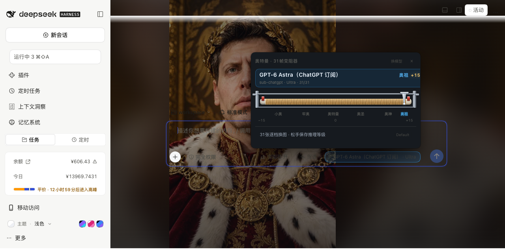

# dsh-boss-slider · 滑动变祖器

> 把 DeepSeek Harness 输入框里的「模型 + 思考强度」换成一台**实体滑动变阻器**：拖滑片就是换档，31 档人像逐帧跟着变。
> A physical rheostat replaces the model/reasoning selector in DSH. 31 frames per model family, one slider.



---

## 它到底做什么

| 位置 | 行为 |
|---|---|
| 输入框模型座位 | 换成一把 31 档滑片：导轨、铜线密绕瓷管、接线柱、滑片，与实物滑动变阻器同构 |
| 滑片位置 | 31 个视觉档位，**只决定图集位置**，不代表推理等级本身 |
| 提交时机 | 松手才提交；拖动过程中只换背景人像，不打断输入 |
| 换模型 | DeepSeek → 梁文锋、GPT → 奥特曼、Claude → 达里奥，各 31 帧独立图集 |
| 真实等级映射 | 视觉档位单独映射到该模型**真实存在**的 `reasoningEfforts`；没有等级元数据时只预览图集，不发虚构等级 |
| 保存失败 | 滑片与人像回滚到已保存档位，并显示错误 |
| 开关 | 开 = 变阻器控件；关 = 恢复原生模型选择器并移除人像背景 |
| 背景 | 拖动时把人像铺成整屏背景，停手 5 秒淡出并精确恢复原样式 |

称号刻度（梁文锋系列，六段覆盖 31 档）：

```
档 01–06  小难梁      档 19–24  梁圣
档 07–12  牢梁        档 25–30  梁神
档 13–18  梁子        档 31     梁祖
```

GPT 系列为 小奥 / 牢奥 / 奥特曼 / 奥圣 / 奥神 / 奥祖，Claude 系列为 小达 / 牢达 / 达里奥 / 达圣 / 达神 / 达祖。

## 安装

### 方式一：插件市场源（推荐）

DSH 网页 → 设置 → **插件市场** → 添加源，填本仓库的市场索引地址：

```
https://raw.githubusercontent.com/bigpowert25-del/dsh-boss-slider/main/market/index.json
```

也可以加 jsDelivr 镜像（国内更快）：

```
https://cdn.jsdelivr.net/gh/bigpowert25-del/dsh-boss-slider@main/market/index.json
```

列表里点 `dsh-boss-slider` 安装，刷新页面一次。

### 方式二：直接用 pnpm 装 git 版本

```bash
# 在 DSH 的 profile 目录里（{DSH_HOME}/profiles/web）
pnpm add git+https://github.com/bigpowert25-del/dsh-boss-slider.git#<commit>
```

### 方式三：本地目录

把仓库放在本机，在 profile 的 `package.json` 里加 `"dsh-boss-slider": "file:/绝对路径/dsh-boss-slider"`，再 `pnpm install`。

装好后在 `cordis.patch.yml` 里要有这一条（仓库里的 `cordis.patch.yml` 会自动被 bundle 带进来）：

```yaml
- insert:
    - id: dsh-boss-slider
      name: 'dsh-boss-slider'
```

> `dsh-boss-slider` 与 `dsh-liang-calibrator` 争同一个模型座位，**只开一个**。

## 网页 demo（不装插件也能看）

| 文件 | 用途 |
|---|---|
| `web/index.html` | 引用 `assets/frames/*.webp`，仓库内直接打开或 GitHub Pages |
| `web/滑动变祖器-单文件.html` | 93 帧全部内联为 data URI，**双击即可看**，断网也行（约 5.2 MB） |

交互：点/拖滑片换档，`←` `→` 微调，`Shift+←/→` 跳 5 档，`Home` / `End` 到两端，右上角切换三个人物系列。

## 目录结构

```
dsh-boss-slider/
├── index.js               host 半身（空 apply，仅让 cordis 能装这个条目）
├── client.js              构建产物：单文件浏览器半身（含 93 帧 data URI）
├── cordis.patch.yml       bundle patch
├── src/
│   ├── core.cjs           模型家族识别、31 档 ↔ 真实推理等级映射、称号
│   ├── backdrop.cjs       整屏背景分层、计时、精确样式恢复
│   ├── client-body.js     实体控件、模型选择、保存与回滚
│   └── style.css          控件样式（自 dsh-liang-calibrator 0.9.3 的 MIT-0 样式派生）
├── build.mjs              用 src + assets/frames 重新生成 client.js
├── tools/build-demo.mjs   生成两个演示页
├── assets/frames/         93 张 31 档人像（liang/sam/dario 各 31）
├── test31.cjs             9 项 TAP 测试
├── market/index.json      插件市场索引（format 1，git 源按 commit 钉死）
├── media/                 预览图、竖屏短视频、抖音文案
└── docs/                  素材来源、验收记录、发布说明
```

## 构建与测试

```bash
node build.mjs            # 重新生成 client.js（会校验 93 帧不重复）
node tools/build-demo.mjs # 重新生成两个演示页
node --test test31.cjs    # 9/9 通过
```

## 素材与授权

- 代码：**MIT-0**（见 `LICENSE`），可任意商用、修改、再发布，无需署名。
- 人像：三段 31 帧人像是**网络梗「滑动变祖器」的二创素材**，来源于公开照片的 AI 编辑与本地补帧，不是官方授权肖像，也不是本仓库的版权主张对象。**仅作个人娱乐与非商业演示**；如需商用请自行替换 `assets/frames/` 里的图（文件名规则见 `build.mjs`）。权利人如认为不妥，提 issue 或邮件联系，仓库会移除对应图集。
- 控件外观（铜线密绕瓷管 + 导轨 + 接线柱 + 滑片）为原版实体滑动变阻器的通用工业造型，不含任何第三方商标。

## 变更记录

- **0.3.0** — 开源整理：93 帧独立成 `assets/frames`，`build.mjs` 可从源码重建 `client.js`；新增两个自包含网页 demo、市场索引 `market/index.json`、MIT-0 LICENSE；版本从 `private` 改为可发布包。
- **0.2.0** — 31 帧全屏人像 + 真实推理等级映射 + 开关与回滚（9/9 测试，浏览器三轮验收）。
- **0.1.0** — 原型：单张老板照片 + 六档推理菜单。

## English

A DSH web plugin: replaces the model/reasoning-effort selector with a real-looking slide-wire rheostat. 31 visual steps per model family (DeepSeek / GPT / Claude), each step mapped to the model's actual `reasoningEfforts`; dragging only swaps the portrait until you release. Ships 93 embedded frames, MIT-0 code, and two standalone HTML demos.
